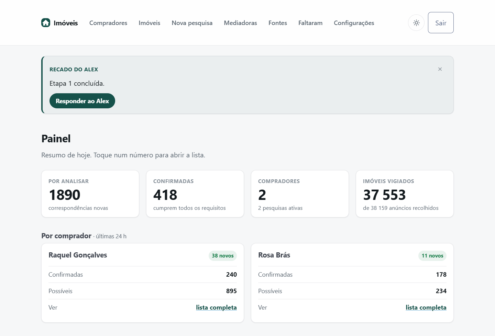
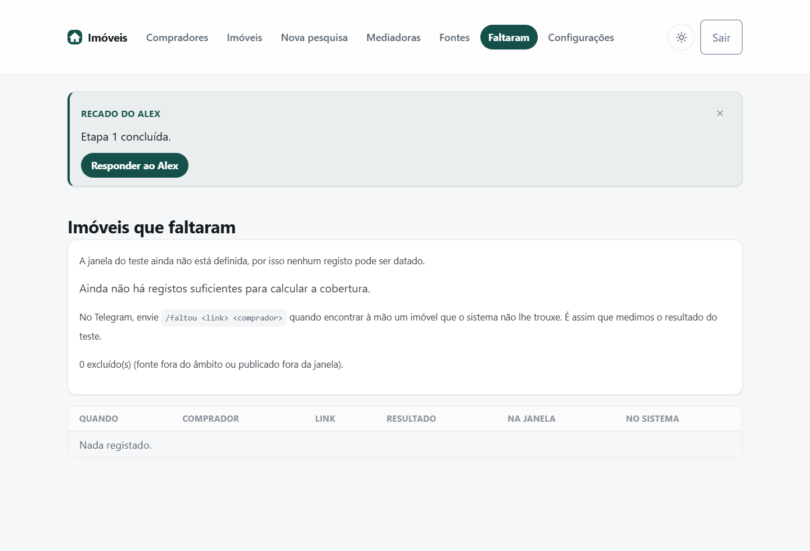
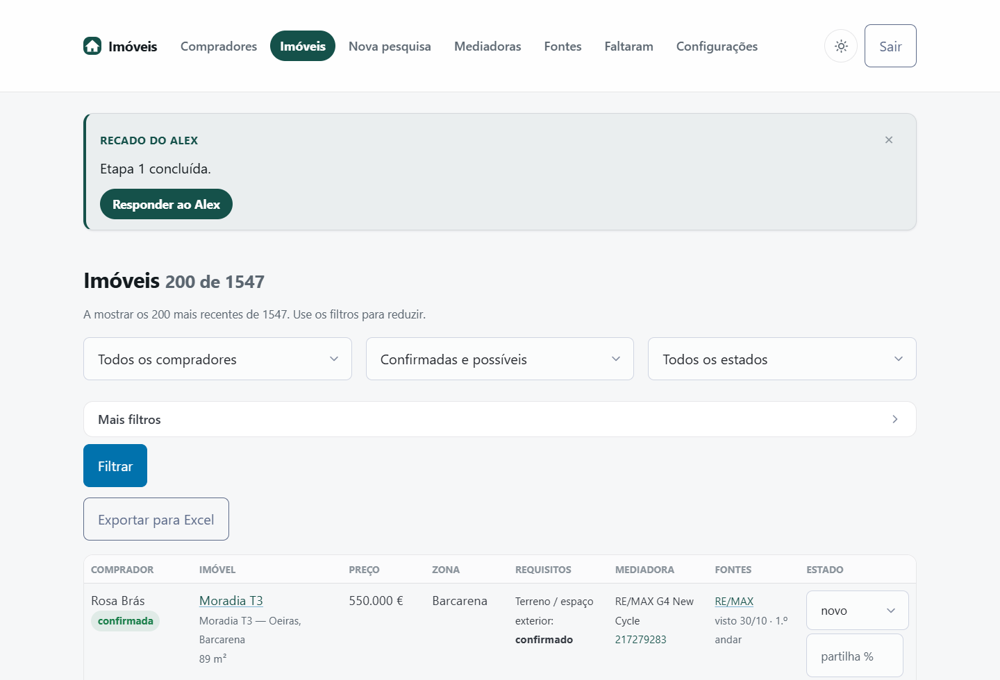
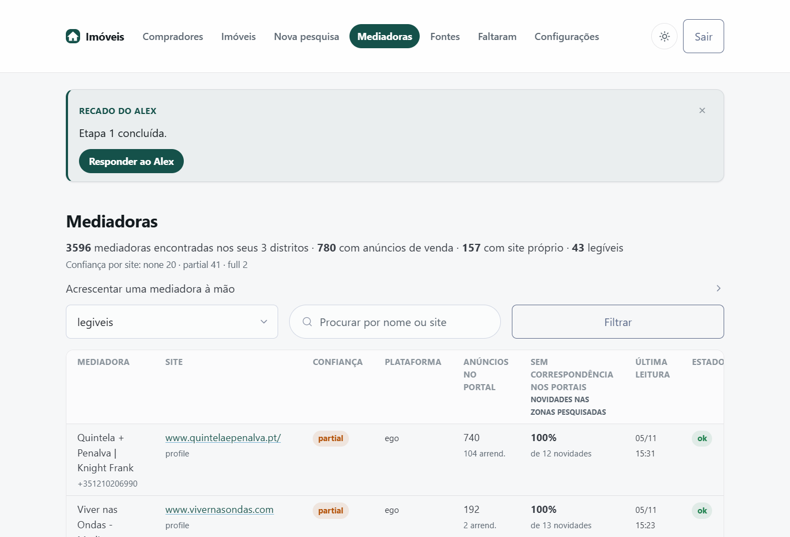
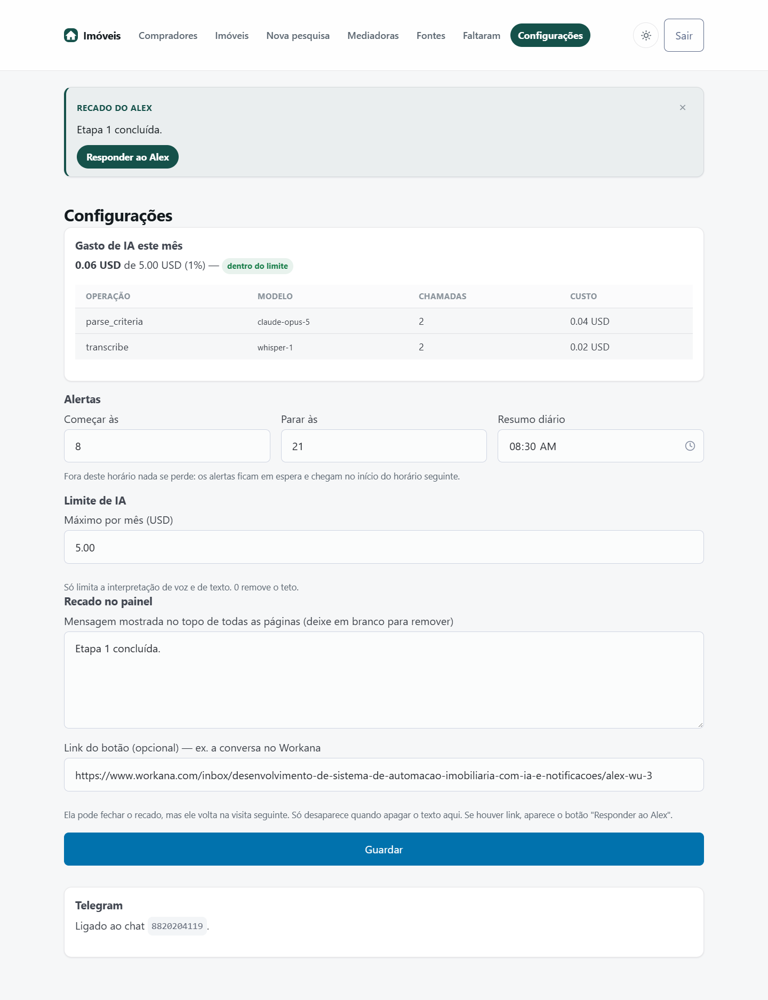
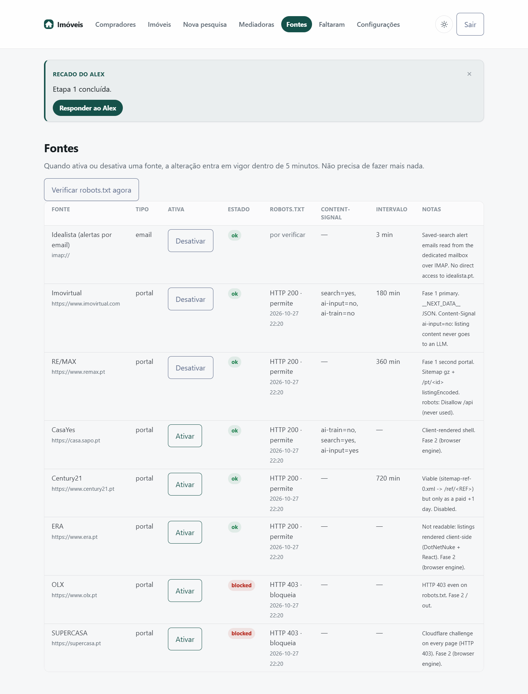

# Manual do sistema de pesquisa imobiliária

Escrito para si, Andreia — não para programadores. Não precisa de saber nada de informática para usar isto.

Se só quiser uma coisa deste manual, é esta: **o sistema procura sozinho, todos os dias, e só lhe manda o
que é novo.** O resto são detalhes.

---

## 1. As duas coisas que vai usar

**O painel**, no computador ou no telemóvel: `https://andreia-imoveis.duckdns.org`
Entra com o seu utilizador e palavra-passe. É onde vê as listas completas, exporta para Excel e muda
configurações.



A primeira página é um resumo do dia. Cada número é um botão: toque e abre a lista por trás dele. O
botão ☀/🌙 em cima à direita troca entre o modo claro e o escuro — as imagens deste manual estão no modo
claro.

**O bot do Telegram**, no telemóvel: `@Andreia_imoveis_bot`
É onde cria pesquisas por voz e recebe os alertas de novidades.

Os dois mostram a mesma informação. O painel é para ver tudo com calma; o Telegram é para ser avisada.

---

## 2. Criar uma pesquisa por voz (o caminho normal)

1. Abra o bot no Telegram.
2. Grave uma nota de voz, como se me estivesse a falar:

   > *"Ana Santos, apartamento T1 ou T2 em Lisboa, entre 300 e 400 mil, com garagem, elevador de
   > preferência."*

3. O sistema transcreve, interpreta e **mostra-lhe o que entendeu**, assim:

   > **Confirma esta pesquisa?**
   > Comprador: **Ana Santos**
   > Apartamento · T1 a T2
   > 300.000 € a 400.000 €
   > Zonas: Lisboa
   > Obrigatório: Garagem
   > Desejável: Elevador
   > Só compra.

4. Três botões: **✅ Confirmar**, **✏️ Corrigir**, **🗑 Cancelar**.

**Nada é criado antes de carregar em Confirmar.** Se o sistema entendeu mal, carregue em Corrigir e escreva
só o que está errado — por exemplo *"é Oeiras, não Lisboa"* ou *"o máximo é 450 mil"*. Não precisa de repetir
tudo.

### Quando ele lhe faz perguntas

Às vezes o cartão traz uma secção **"Preciso de confirmar"**. Por exemplo:

> • *"Lisboa" pode ser distrito (lisboa) ou concelho (lisboa/lisboa). Qual deles?*

Isto é de propósito. "Lisboa" pode significar a cidade ou todo o distrito, e a diferença são milhares de
imóveis. **O sistema prefere perguntar a adivinhar** — se adivinhasse mal, receberia imóveis de Torres Vedras
numa pesquisa para a Baixa. Responda com o botão Corrigir.

### A primeira lista não vem para o Telegram

Quando confirma, o sistema faz uma **primeira busca completa** — pode dar centenas de imóveis. Essa lista
aparece **no painel**, não no Telegram. Se viessem todos por mensagem seriam 300 notificações no primeiro dia.

Depois dessa primeira vez, **só recebe as novidades**.

---

## 3. Criar uma pesquisa no painel (sempre funciona)

No painel: **Compradores → Nova pesquisa**. Preenche um formulário com os mesmos campos.

Use este caminho se preferir escrever, ou se o bot lhe disser que não consegue interpretar. **O formulário
nunca depende da inteligência artificial**, por isso funciona sempre, mesmo se o limite de gastos de IA
tiver sido atingido.

---

## 4. Os alertas

Quando aparece um imóvel novo que corresponde a um comprador, recebe uma mensagem assim:

> 🆕 **Nova oportunidade**
> **Apartamento T2 · 385.000 € · 78 m²**
> Alcântara, Lisboa
> Para **Ana Santos** (confirmada) — Garagem: confirmada
> Mediadora: Quintela + Penalva · 212454059
> Ver: imovirtual · quintelaepenalva.pt

E por baixo, botões: **👀 Analisado · 📞 Contactado · ✅ Disponível · ❌ Indisponível**

Carregue no botão à medida que trata do imóvel. O que marcar fica guardado e aparece no painel, para não
voltar a ligar duas vezes pelo mesmo imóvel. O botão em que carregou fica marcado com um ponto (•).

### Os quatro casos em que é avisada

1. **Imóvel novo** numa fonte que lemos, que corresponde a um comprador.
2. **Baixou de preço** e entrou (ou continua) no orçamento do comprador.
3. **O anúncio foi completado** — faltava dizer se tinha elevador, agora diz, e passou a corresponder.
4. **Alterou os critérios** de um comprador e há imóveis já guardados que passaram a servir.

### "Confirmada" e "possível"

- **Confirmada** — tudo o que é obrigatório está confirmado no anúncio.
- **Possível** — falta informação. O anúncio não diz se tem garagem, ou não indica o preço.

Nunca lhe digo "confirmada" quando o anúncio não diz. Isso faria perder tempo em visitas erradas.

### Horário

Por omissão recebe alertas **das 08:00 às 21:00**, e o resumo diário às **08:30**. Fora desse horário
**nada se perde**: se aparecer um imóvel às duas da manhã, a mensagem fica à espera e chega às oito.

---

## 5. O resumo diário

Uma mensagem por dia, à hora que escolher:

> **Resumo de 31/10**
> **Rosa Brás**: 3 novo(s) · 1 confirmada(s) · 2 possível(eis)
> Raquel Gonçalves: sem novidades

Recebe-o **mesmo nos dias sem novidades**. É de propósito: assim sabe que o sistema está a funcionar, em vez
de ficar na dúvida se está parado.

---

## 6. Pausar um comprador

No Telegram: `/pausar Rosa Brás` e `/retomar Rosa Brás`
No painel: botão **Pausar** na página do comprador.

Com o comprador em pausa:

- **continuo a vigiar e a guardar tudo** no painel;
- **não lhe mando alertas**;
- quando retomar, **não recebe de repente tudo o que acumulou** — só o que aparecer dali para a frente.

Era isto que me pediu: os clientes em pausa não perdem oportunidades, mas também não lhe enchem o telemóvel.

---

## 7. Comandos do Telegram

| Comando | O que faz |
|---|---|
| `/estado` | Como estão os compradores, e o horário de alertas |
| `/pausar Nome` | Para os alertas desse comprador |
| `/retomar Nome` | Volta a mandar |
| `/faltou <link>` | Um imóvel que encontrou à mão e eu não trouxe |
| `/ajuda` | Este resumo |

### `/faltou` é importante

Sempre que encontrar à mão um imóvel que o sistema não lhe trouxe, mande-me o link com `/faltou`. Ele
responde logo a dizer em que categoria caiu:

- *"Já tínhamos este imóvel"* — estava no painel;
- *"Falha nossa"* — é de uma fonte que lemos e não o trouxemos. **Estes são os que contam contra nós.**
- *"Fora do âmbito"* — é de uma fonte que ficou de fora por escrito.

É assim que medimos se o sistema está a cumprir os 80 % que combinámos. Pode ver a contagem em
**Painel → Faltaram**.



---

## 8. O painel, página por página

| Página | Para que serve |
|---|---|
| **Compradores** | Criar, pausar e ver cada comprador e as suas pesquisas |
| **Imóveis** | Todos os imóveis encontrados, com filtros, estados e **exportação para Excel** |
| **Nova pesquisa** | O formulário (alternativa à voz) |
| **Fontes** | Os portais e o email: se algum deixou de funcionar, aparece aqui |
| **Mediadoras** | As mediadoras encontradas, o nível de leitura de cada site, e acrescentar à mão |
| **Faltaram** | A contagem do teste: o que encontrou à mão e nós não |
| **Configurações** | Horário dos alertas, hora do resumo, limite de gastos de IA |



Na página **Imóveis**, cada linha é um imóvel, não um anúncio: se o mesmo T2 está em quatro sites,
aparece-lhe uma vez só, com os quatro links na coluna *Fontes*. A coluna *Mediadora* traz o telefone, e
num telemóvel basta tocar no número para ligar. O botão **Exportar para Excel** guarda exactamente o que
está a ver, já filtrado.



### Níveis de leitura das mediadoras

Na página Mediadoras, cada site tem um nível:

- **full** — o site publica tudo de forma organizada: preço, tipologia, área, zona. Lemos tudo.
- **partial** — o site publica menos. Conseguimos ler, mas parte da informação vem do texto do anúncio, por
  isso alguns imóveis aparecem como "possível".
- **none** — não conseguimos ler, e a razão está escrita ao lado. Às vezes é o próprio site a proibir a
  leitura automática (é o caso do `residential.jll.pt`); outras vezes a estrutura não é reconhecível.

Pode acrescentar quantas mediadoras quiser, em **Mediadoras → Acrescentar uma mediadora à mão**. Não há
limite.

---

## 9. O limite de gastos de inteligência artificial

Em **Configurações** vê quanto gastou este mês e pode definir o máximo.



A IA é usada em duas coisas apenas: transcrever as suas notas de voz, e interpretar os critérios. **Não é
usada para procurar imóveis** — isso é feito por regras, e não custa nada por imóvel.

Quando chega a 80 % do limite, recebo-lhe um aviso. Quando chega ao limite:

- **deixa de interpretar notas de voz**;
- **as pesquisas, as comparações e os alertas continuam a funcionar normalmente**;
- pode continuar a criar pesquisas no formulário do painel.

Nunca o limite de IA para o sistema. Só para a parte da voz.

---



---

## 10. Quando algo parece estar mal

**"Não recebo alertas"**
Verifique em **Configurações** se o Telegram aparece como ligado. Se não, abra o bot e carregue em Start.
Confirme também o horário: fora dele os alertas ficam à espera.

**"Um portal deixou de aparecer"**
Veja a página **Fontes**. Se um portal mudou a estrutura do site, aparece lá a dizer, e recebe uma mensagem
no Telegram. Isto acontece de vez em quando e é normal neste tipo de automação — avise-me e eu ajusto.

**"Recebi o mesmo imóvel duas vezes"**
Pode acontecer quando o mesmo imóvel está em dois sítios com fotografias diferentes e sem referência comum.
Mande-me o caso. No painel, o botão **"Não é o mesmo imóvel"** faz o contrário: separa dois anúncios que
foram juntados por engano.

**"O bot diz que não consegue interpretar"**
Ou o limite de IA foi atingido (veja Configurações), ou o serviço está indisponível. Use o formulário do
painel — funciona sempre.

---

## 11. O que o sistema não faz

Prefiro que saiba isto de antemão:

- **Idealista** — não lemos o site diretamente. Lemos os **alertas de email** das suas pesquisas guardadas.
  Por isso é importante que essas pesquisas existam e sejam largas.
- **SUPERCASA, OLX, CasaYes, ERA** — bloqueiam a leitura automática. Ficaram de fora desta fase.
- **Century21** — fica para depois desta fase.
- **Casafari** — o seu plano não inclui acesso técnico (confirmado por eles), por isso está fora.
- **Facebook e Instagram** — fora desta fase.
- **Cobertura nunca é 100 %.** Nenhum sistema deste tipo apanha tudo. O objetivo é apanhar a grande maioria
  e poupar-lhe as horas de consulta manual.
- **"Tempo real" significa intervalos curtos**, não instantâneo: os portais são consultados a cada 2–4
  horas, os sites de mediadoras uma a duas vezes por dia, e os emails do Idealista são lidos de imediato.

---

## 12. Onde estão as suas coisas

- **Servidor**: na sua conta Hetzner, em seu nome.
- **Base de dados**: no servidor, com **cópia de segurança automática todas as noites** (guardam-se as
  últimas 14).
- **Chaves de IA**: nas suas contas, em seu nome. Pode apagá-las quando quiser.
- **Código**: entregue a si, com documentação, para que outro programador possa continuar.

---

## 13. Imagens

As imagens deste manual são capturas do **seu** painel, com os seus dados reais, tiradas a 5 de novembro
de 2026. Nenhuma é inventada ou de demonstração. Ficam em `docs/manual_pt/images/`.

| Imagem | Página |
|---|---|
| `painel.png` | Painel |
| `imoveis-filtros.png` | Imóveis |
| `mediadoras.png` | Mediadoras |
| `fontes.png` | Fontes |
| `configuracoes.png` | Configurações |
| `cobertura.png` | Faltaram |

Os números que vê nelas são os do dia em que foram tiradas e mudam todos os dias — servem para reconhecer
a página, não para a informação.

Para as voltar a tirar depois de alguma alteração ao painel:

```sh
PANEL_PASSWORD=... python -m scripts.capture_manual_images https://andreia-imoveis.duckdns.org
```

**Faltam duas imagens do Telegram** — o cartão de confirmação de uma pesquisa, e um alerta com os botões
de estado. Essas não se tiram do painel: são conversas no telemóvel, e as suas ainda são poucas. Tiro-as
da minha própria conversa de testes e acrescento-as aqui.
